# Scaffold-freeze then Train (Path 1)

**Status snapshot:** freeze+gates+P5.0 done · **P5.1a-r5c PASS** yield=0.9375 · **P5.1a-r6** broadened yield~0.13 · **P5.1a-r7b** partial with 2 unique `rich_2943` patches merged into SFT · **P5.1a-r7d DONE** yield=0.0 (0/80) · **P5.1b-star-r1 DONE** recoveries=1/9 · LB branches: frozen **0.06** · public notebook **0.18** · P3.13 hybrid **0.13**
**Single source of truth for live status:** [`experiment_log.md`](./experiment_log.md)
**Harvest ops (agents):** [`gemma4-agent/docs/harvest_runpod.md`](../gemma4-agent/docs/harvest_runpod.md)

## Decision (locked)

- Shipping zip stays `gemma4-agent/agent/` as of P3.8: wall 4, temp 0.0, graph-first, soft edit-by-12. Keep P3.2b / P3.10 / P3.12 reverted.
- Log `GATE_P3 = FAIL` on edit/loop KPIs, plus operator **PIVOT**: scaffold freeze and unlock training.
- Log `GATE_P4 = PIVOT | topology=single | skipped=true`.
- Unlock Phase 5: BoN+STaR → DoRA SFT → GRPO → TIES. SimPO only if GRPO fails. No PRM. Rank ≤64.

```mermaid
flowchart LR
  keep[Kept_P38_agent] --> freeze[Scaffold_freeze]
  freeze --> g3[GATE_P3_FAIL_PIVOT]
  g3 --> g4[GATE_P4_PIVOT_single]
  g4 --> p50[P5.0_policy]
  p50 --> bon[P5.1a_BoN]
  bon -->|verify_bug| fix[host_deps_oracle]
  fix --> r4[P5.1a_r4_temp0]
  r4 -->|yield_0.75| r5[P5.1a_r5_N8]
  r5 --> render[P5.5_render]
  render --> sft[P5.6_DoRA]
  sft --> ab[P5.8_dev_AB]
  ab --> zip[New_LB_zip_if_up]
```

## BoN results

| Run | Pool | N | Temp | Yield | Note |
| --- | --- | --- | --- | --- | --- |
| P5.1a | smoke×10 | 4 | 0.2 | **0/40** | verify false-neg; traces lost |
| P5.1a-r2 | 8 known-solvable | 4 | 0.2 | **0/32** | 32/32 patched; same bug |
| P5.1b | same 8 | STaR | — | 0 recoveries | pre-fix blind retries |
| P5.1a-r3 | same 8 | 1 | 0.0 | **0/8** | proved not sampling |
| **P5.1a-r4** | same 8 | 1 | 0.0 | **0.75 (6/8)** | host pytest+starlette; oracle PASS |
| **P5.1a-r5c** | same 8 | **8** | **0.2** | **0.9375 (60/64)** | G3 scale-N win after host fix |
| **P5.1a-r6** | broadened pool | **8** | **0.2** | **~0.13** | broadening added diversity but weak yield |
| **P5.1a-r7b** | 16-task freeze resume | **8** | **0.2** | partial **6/15 raw** | operator stop after first hit; 2 unique `rich_2943` patches survived merge |
| **P5.1a-r7c** | remaining 14 | **8** | **0.2** | partial **0/27** | clean persisted stop; no keepers |
| **P5.1a-r7d** | remaining 10 non-rich first | **8** | **0.2** | **0.0 (0/80)** | oracle PASS; watchdog harvested; pod off; mixed timeout/test/apply failures |
| **P5.1b-star-r1** | 9 r6 near-misses | STaR | — | **1/9 recoveries** | 1 clean new row; 5 misses were harness-dep blocked |

## LB Standing

- Frozen scaffold public score: **0.06**
- Public notebook baseline: **0.18**
- `P3.13` hybrid: **0.13** and therefore a regression vs `0.18`
- Leaders are already around **0.25**
- Standing rule: compare future public submits to exact `0.18`, not to `0.06`
- Do **not** reopen broad prompt-hygiene hybrids on top of the notebook line without single-variable attribution

## Optimal strategy (GPU RunPod + Kaggle)

| Stream | Work | Why |
| --- | --- | --- |
| **GPU primary** | Fix subprocess harness deps, then re-run broadened BoN/STaR | Current STaR misses are polluted by env misses, not just model misses |
| **GPU secondary** | STaR only on stubborn fails after deps+oracle are clean | Recovery signal is real but too weak/noisy to scale yet |
| **CPU** | `render_trajectories.py` + filter | Unblocks DoRA when keepers grow |
| **Kaggle** | At most 1 single-variable zip/day | Convert 0.06 → signal without scaffold churn |

Replace the old Kaggle rule mentally with: preserve **0.18** first, then spend at most one daily slot on a single-variable ablation from exact `0.18`.

## Ops lessons

- Sync `traces/` to S3 **before** terminate.
- Require host CUDA driver ≥13 for vllm 0.31 / torch cu130.
- Avoid `nvidia-smi | head` under `set -o pipefail`.
- **Always** `ensure_subprocess_host_deps` + gold `rich_3882` oracle before BoN.
- STaR watchdog exit must wait for `S3_PERSIST_DONE`, not `STAR_COMPLETE`.
- Subprocess extras (`inline_snapshot`, `dirty_equals`) must stay on host via `ensure_subprocess_host_deps` + pin; preflight now fails closed if missing.

## Freeze rules

- Ban: edit-arg lectures, force-edit-by-12, grep-first, community 28-call, wall under 4 without LB timeout proof (except deliberate wall-only A/B).
- No new daily zip until deliberate wall probe or train A/B win.

## Phase 5 kickoff

| Step | Ticket | Work | DoD |
| --- | --- | --- | --- |
| 1 | P5.0 | distillation policy | **done** |
| 2 | cloud | `CLOUD_APPROVAL` P5A | **live** to 2026-10-13T16:33:07Z |
| 3 | P5.1a–r3 | BoN/STaR under broken verify | **done / FAIL** |
| 4 | P5.1a-r4 | host deps + temp0 | **PASS** yield=0.75 |
| 5 | P5.1a-r5c / r6 | BoN N=8 scale + broaden | **done** |
| 6 | P5.1b-star-r1 | STaR on r6 near-misses | **done** recoveries=1/9 |
| 7 | P5.2 / P5.5 | Filter + render SFT | **done** 67 rows / 11 tasks (`fastapi_11194` + `rich_2943` merged) |
| 8 | harness deps | pin+preflight sandbox extras | **done** 2026-10-11 |
| 8b | P3.15a | exact 0.18 + 12B model-only smoke | zip ready; blocked on approval/slot |
| 9 | P5.6–P5.8 | DoRA r≤64 + dev A/B | Δ Pass@1 ≥ +0.05 abs (after more keepers) |
| 10 | submit | New LB zip if A/B wins | ≤1/day from exact 0.18 |

## Do not

- Multi-agent P4; more edit-prompt ablations; train holdout; ship adapter without A/B; cloud without approval; skip oracle gate; terminate before S3 sync; SFT on 6 trajs alone.

## Status 2026-10-12 (DS)

- `data_train/sft.jsonl`: **67 clean rows / 11 tasks** (`fastapi_11194` STaR + `rich_2943` merge).
- Host pin/preflight hardened for `inline_snapshot` / `dirty_equals`.
- Public standing baseline: exact **0.18**; `P3.15a` 12B model-only smoke **FAIL** (`Pass@1=0.10`) so default stays **31B**.
- `P5.1a-r7d`: complete harvest with oracle PASS, **80 metas / 0 keepers**, artifacts in `gemma4-agent/results/p51a_r7d/` and `gemma4-agent/results/p51a_r7d_filtered/`.
- Pod `esuxchhvwae76g` is off after harvest (`ssh` endpoint refused).
- Next: CPU autopsy on `r7d` fail classes before another GPU spend; keep default **31B** / freeze agent path.

## Path To 0.25 (after any hypothetical `P3.15b` read)

Treat `P3.15b` as a final 12B keep/kill read only, not the main climb path. If it does not beat or clearly de-risk the **31B** line, stop public model-size churn immediately and return to the locked 31B training path:

1. CPU autopsy `P5.1a-r7d` fail classes and choose exactly one repair axis.
2. Re-run clean **31B** freeze BoN/STaR on the repaired axis to grow keeper/task coverage.
3. Re-filter/render into `data_train/sft.jsonl`; do not start DoRA on a tiny incremental bump.
4. Run **P5.6 DoRA SFT** (`r<=64`) only after keeper growth is material.
5. Run **P5.7/P5.8** 4-bit serve check + dev A/B; only then spend the next scoring slot.

Interpretation: the next realistic path from **0.18** toward **0.25** is better 31B post-training data plus adapter A/B, not an open-ended sequence of `P3.x` public probes.
