# Scaffold-freeze then Train (Path 1)

**Status:** freeze+gates+P5.0 done · **P5.1a-r5c PASS** yield=0.9375 · **P5.1a-r6** broadened yield~0.13 · **P5.1b-star-r1 DONE** recoveries=1/9 · LB public **0.06**
**Canonical ops log:** [`experiment_log.md`](./experiment_log.md)  
**Harvest ops (agents):** [`gemma4-agent/docs/harvest_runpod.md`](../gemma4-agent/docs/harvest_runpod.md)

## Decision (locked)

- Shipping zip stays `gemma4-agent/agent/` as of P3.8: wall 4, temp 0.0, graph-first, soft edit-by-12. Keep P3.2b / P3.10 / P3.12 reverted.
- Log `GATE_P3 = FAIL` on edit/loop KPIs, plus operator **PIVOT**: scaffold freeze and unlock training.
- Log `GATE_P4 = PIVOT | topology=single | skipped=true`.
- Unlock Phase 5: BoN+STaR → DoRA SFT → GRPO → TIES. SimPO only if GRPO fails. No PRM. Rank ≤64.

```mermaid
flowchart LR
  keep[Kept_P38_agent] --> freeze[Scaffold_freeze]
  freeze --> g3[GATE_P3_FAIL_PIVOT]
  g3 --> g4[GATE_P4_PIVOT_single]
  g4 --> p50[P5.0_policy]
  p50 --> bon[P5.1a_BoN]
  bon -->|verify_bug| fix[host_deps_oracle]
  fix --> r4[P5.1a_r4_temp0]
  r4 -->|yield_0.75| r5[P5.1a_r5_N8]
  r5 --> render[P5.5_render]
  render --> sft[P5.6_DoRA]
  sft --> ab[P5.8_dev_AB]
  ab --> zip[New_LB_zip_if_up]
```

## BoN results

| Run | Pool | N | Temp | Yield | Note |
| --- | --- | --- | --- | --- | --- |
| P5.1a | smoke×10 | 4 | 0.2 | **0/40** | verify false-neg; traces lost |
| P5.1a-r2 | 8 known-solvable | 4 | 0.2 | **0/32** | 32/32 patched; same bug |
| P5.1b | same 8 | STaR | — | 0 recoveries | pre-fix blind retries |
| P5.1a-r3 | same 8 | 1 | 0.0 | **0/8** | proved not sampling |
| **P5.1a-r4** | same 8 | 1 | 0.0 | **0.75 (6/8)** | host pytest+starlette; oracle PASS |
| **P5.1a-r5c** | same 8 | **8** | **0.2** | **0.9375 (60/64)** | G3 scale-N win after host fix |
| **P5.1a-r6** | broadened pool | **8** | **0.2** | **~0.13** | broadening added diversity but weak yield |
| **P5.1b-star-r1** | 9 r6 near-misses | STaR | — | **1/9 recoveries** | 1 clean new row; 5 misses were harness-dep blocked |

## LB (2026-10-09)

- Public score **0.06** (submit infra partly recovered; leaders ~0.17–0.24).
- Smoke/dev ≫ LB → likely timeouts/coverage; next zip ablation = **wall 3–3.5 only** if daily slot.
- Do **not** reopen edit-prompt A/Bs (GATE_P3 pivot).

## Optimal strategy (GPU RunPod + Kaggle)

| Stream | Work | Why |
| --- | --- | --- |
| **GPU primary** | Fix subprocess harness deps, then re-run broadened BoN/STaR | Current STaR misses are polluted by env misses, not just model misses |
| **GPU secondary** | STaR only on stubborn fails after deps+oracle are clean | Recovery signal is real but too weak/noisy to scale yet |
| **CPU** | `render_trajectories.py` + filter | Unblocks DoRA when keepers grow |
| **Kaggle** | At most 1 single-variable zip/day | Convert 0.06 → signal without scaffold churn |

## Ops lessons

- Sync `traces/` to S3 **before** terminate.
- Require host CUDA driver ≥13 for vllm 0.31 / torch cu130.
- Avoid `nvidia-smi | head` under `set -o pipefail`.
- **Always** `ensure_subprocess_host_deps` + gold `rich_3882` oracle before BoN.
- STaR watchdog exit must wait for `S3_PERSIST_DONE`, not `STAR_COMPLETE`.
- Subprocess wheelhouse is still missing `inline_snapshot` and `dirty_equals`; unresolved STaR counts are inflated until that is fixed.

## Freeze rules

- Ban: edit-arg lectures, force-edit-by-12, grep-first, community 28-call, wall under 4 without LB timeout proof (except deliberate wall-only A/B).
- No new daily zip until deliberate wall probe or train A/B win.

## Phase 5 kickoff

| Step | Ticket | Work | DoD |
| --- | --- | --- | --- |
| 1 | P5.0 | distillation policy | **done** |
| 2 | cloud | `CLOUD_APPROVAL` P5A | **live** to 2026-10-10T10:53:48Z |
| 3 | P5.1a–r3 | BoN/STaR under broken verify | **done / FAIL** |
| 4 | P5.1a-r4 | host deps + temp0 | **PASS** yield=0.75 |
| 5 | P5.1a-r5c / r6 | BoN N=8 scale + broaden | **done** |
| 6 | P5.1b-star-r1 | STaR on r6 near-misses | **done** recoveries=1/9 |
| 7 | P5.2 / P5.5 | Filter + render SFT | **done** 65 rows / 9 tasks; +1 STaR row held out pending env fix |
| 8 | harness deps | add `inline_snapshot` + `dirty_equals` to subprocess path | unblock clean harvest labels |
| 9 | P5.6–P5.8 | DoRA r≤64 + dev A/B | Δ Pass@1 ≥ +0.05 abs |
| 10 | submit | New LB zip if A/B wins | ≤1/day |

## Do not

- Multi-agent P4; more edit-prompt ablations; train holdout; ship adapter without A/B; cloud without approval; skip oracle gate; terminate before S3 sync; SFT on 6 trajs alone.

## Status 2026-10-09 (DS)

- `data_train/sft.jsonl`: **65 clean rows / 9 tasks** from r4+r5c+r6.
- `results/p51b_star_r1/`: **1 clean new STaR row** (`fastapi_11194`) not yet merged into main SFT pool.
- `P5.1b-star-r1`: wall `3287.96s`, recoveries `1/9`, exact duplicate vs current SFT `0`.
- Failure audit on STaR misses: `5` missing-dep (`inline_snapshot` / `dirty_equals`), `1` import-error follow-on, `2` genuine assertion-fail misses.
- Next DS action: fix subprocess harness deps before spending more GPU on broadened harvest or STaR.
